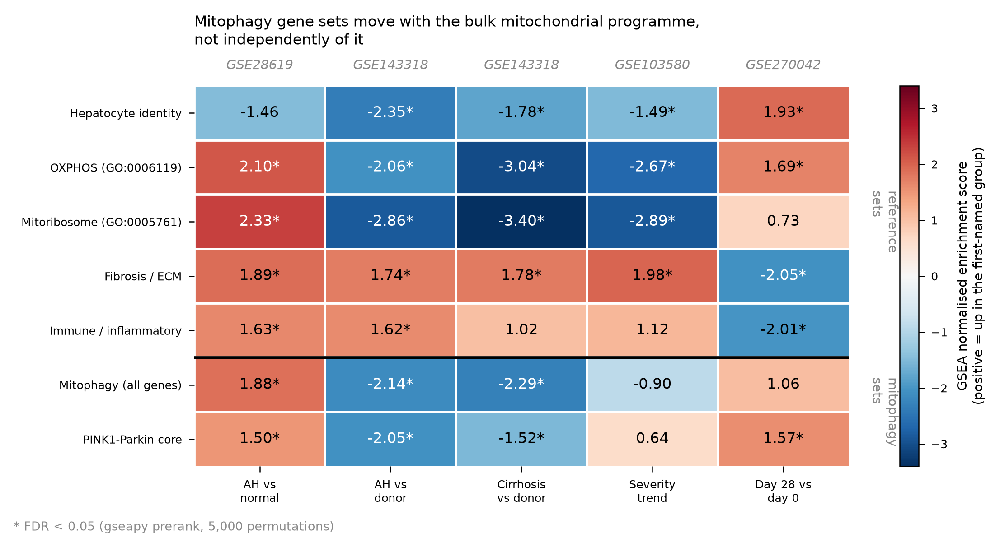

# Mitophagy in alcohol-related liver disease

An independent reanalysis of four public human liver transcriptome cohorts, asking
whether mitophagy — and PINK1/Parkin-mediated mitophagy in particular — is
transcriptionally altered in alcohol-related liver disease (ALD), and whether any
change reverses when the disease resolves.

**The short answer: the pathway-level signal is not specific.** Mitophagy transcripts
track the bulk mitochondrial programme, which in turn tracks how much hepatocyte is
left in the biopsy. The apparent direction of mitophagy "enrichment" reverses between
cohorts. Tested competitively against a curated mitochondrial background, the mitophagy
set shifts *in the same direction as that background but consistently less far* — the
opposite of what a specifically regulated pathway looks like.



*GSEA normalised enrichment scores across five contrasts. Reference sets above the
rule, mitophagy sets below it. Note that the mitophagy rows never exceed the
mitochondrial reference rows in magnitude, and change sign with them.*

---

## Findings

**1. Pathway direction is cohort-dependent, not disease-dependent.**
The mitophagy gene set is enriched *upward* in GSE28619 (NES +1.88) and *downward* in
GSE143318 (NES −2.14) for the same nominal contrast — alcoholic hepatitis versus
non-diseased liver. Both are statistically significant. Taken alone, either would
support a confident and opposite conclusion.

**2. The reference sets explain the reversal.** Hepatocyte-identity, OXPHOS and
mitoribosomal gene sets move in the same pattern as mitophagy in every cohort. What
differs between cohorts is the comparator tissue and the degree of hepatocyte loss,
not mitophagy regulation.

**3. Competitive testing against a matched background.** Mann–Whitney U comparing the
mitophagy set's test statistics against a mitochondrial background defined from curated
GO terms (GO:0006119 oxidative phosphorylation ∪ GO:0005761 mitochondrial ribosome):

| Contrast | median mitophagy | median mito. background | FDR |
|---|---|---|---|
| GSE103580 — ALD severity trend | -0.07 | -1.62 | 1.2e-14 |
| GSE143318 — AH vs Normal | -1.80 | -2.72 | 5.1e-03 |
| GSE143318 — AlcCirrhosis vs Normal | -1.44 | -2.66 | 3.2e-09 |
| GSE28619 — AH vs Normal | +1.69 | +2.55 | 9.5e-02 |

Same direction as the background, smaller magnitude, in all four disease contrasts —
significant in three. The GSE28619 result is borderline (FDR 0.095) and is **not robust
to how the background is defined**; see "A claim that was withdrawn" below.

**4. Gene-level signals survive the confounding.** Nine mitophagy genes replicate at
FDR < 0.05 in at least three of four disease contrasts with consistent direction.
*BNIP3* is down in **all four**, on both microarray and RNA-seq platforms
(log2FC −0.27 to −1.18). *OPTN* is up in three. Receptor-mediated mitophagy, not the
PINK1/Parkin arm, carries the reproducible signal.

**5. *PRKN* is near array background in liver tissue** (mean log2 intensity 2.3–3.5
against *ALB* at 13.1–15.4), so PINK1/Parkin conclusions drawn from bulk liver
expression data rest on a transcript that is barely measured there.

---

## A claim that was withdrawn

Revision 1 of the report stated that the PINK1-Parkin core module rises during clinical
recovery in GSE270042 (NES +1.58, p = 0.022, FDR 0.093).

Library sizes in that cohort span 2.15M to 40.95M reads, and seven libraries fall below
10M. Repeating the analysis with those seven excluded collapses the result to
NES +0.90, p = 0.61, FDR 1.00. **The claim was withdrawn and the report reissued.**

What survives the sensitivity analysis is a compositional result: recovery restores the
hepatocyte compartment (hepatocyte identity NES +2.29, fibrosis/ECM −2.21, immune −2.21,
all FDR < 0.001) with no detectable module-level mitochondrial or mitophagy change
(mitochondrial background NES −0.65, FDR 0.93).

This is documented rather than quietly removed because the sensitivity analysis is the
most informative thing in the repository.

---

## Cohorts

| Accession | Platform | Assay | n | Groups |
|---|---|---|---|---|
| `GSE103580` | GPL13667 Affymetrix HG-U219 | microarray | 86 | Alcoholic cirrhosis 67; Alcoholic steatosis 6; Mild alcoholic hepatitis 13 |
| `GSE143318` | GPL18573 Illumina NextSeq 500 | RNA-seq | 25 | Alcoholic cirrhosis 5; Alcoholic hepatitis 13; Donor liver 7 |
| `GSE270042` | GPL30173 Illumina NextSeq 2000 | RNA-seq | 65 | Alcoholic hepatitis (day 0) 33; Alcoholic hepatitis (day 28) 32 |
| `GSE28619` | GPL570 Affymetrix HG-U133 Plus 2.0 | microarray | 22 | Alcoholic hepatitis 15; Normal liver 7 |

Chosen for complementary designs — two platforms, three disease stages, one paired
treatment time course — rather than for maximum sample size.

---

## Repository layout

```
report/     report.md          the full write-up (revision 2, corrected)
            DECISIONS.md       every analytical choice, with justification
            VERIFICATION.md    independent re-checking of the published results
figures/    fig1-fig4          figures as they appear in the report
code/       download_data.py   fetches the raw GEO files (not committed here)
            de_analysis.py     differential expression and module GSEA
            reference_sets_gsea.py  curated GO reference sets and Figure 1
data/       genesets/          the 154-gene mitophagy set, by module
            metadata/          harmonised sample annotation and gene universe
            MATRICES.md        provenance of every expression matrix
results/    all derived tables, including the full DE output
```

Raw expression matrices are **not committed**. `code/download_data.py` fetches them
from GEO, which keeps provenance with NCBI rather than with this repository and keeps
the repository small.

---

## Reproducing

```bash
git clone https://github.com/oladipupo-m/mitophagy-ald-transcriptomics.git
cd mitophagy-ald-transcriptomics
conda create -n mitophagy-ald python=3.11
conda activate mitophagy-ald
pip install -r requirements.txt
python code/download_data.py      # fetches ~200 MB from GEO
python code/de_analysis.py
python code/reference_sets_gsea.py
```

Retrieval, gene-set construction, alias reconciliation and the competitive test were
run interactively and are **not yet in a single script** — `report/DECISIONS.md` is the
record of those steps. Consolidating them into one pipeline is the main outstanding
work on this repository.

---

## Limitations

These bound what the results can be used for, and are stated here rather than buried.

1. **No deconvolution.** Cell composition is *controlled for* by reference sets, not
   *adjusted for*. Every conclusion is therefore comparative — "mitophagy moves less
   than the mitochondrial background" — never absolute. Deconvolution against a liver
   single-cell reference would convert this caveat into an adjustment.
2. **GSE143318 sample linkage is inferred.** The deposited count matrix uses internal
   labels (`N1`, `AC1`, `AH1`) and `!Sample_supplementary_file` is `NONE` throughout,
   so counts cannot be machine-matched to GSM records. Group assignment comes from the
   column prefix. This is a permanent limitation of the deposit, not a processing choice.
3. **mRNA is not flux.** Mitophagy is a flux phenomenon and transcript abundance is a
   poor proxy for it. Nothing here measures mitophagic flux.
4. **Microarray contrasts were not re-run under limma.** PyDESeq2 was used throughout
   after Bioconductor proved uninstallable on the development machine. This matters most
   for GSE28619, whose specificity result is already borderline.
5. **FDR was recomputed outside DESeq2** for cross-platform uniformity, forgoing
   DESeq2's independent filtering.
6. **GSE270042 is analysed with all 65 libraries as primary**, with the seven low-depth
   libraries excluded as a sensitivity analysis. The reverse would be the better default.

---

## Status

Independent work, not peer reviewed and not submitted. No institutional affiliation is
claimed for it. It uses only public data and contains no unpublished material from any
laboratory.

## Licence

Code: MIT. Report, figures and derived tables: CC BY 4.0.

## Author

Oladipupo Mamukuyomi — MSc Biomedical Science (Clinical Biochemistry),
University of Westminster.
