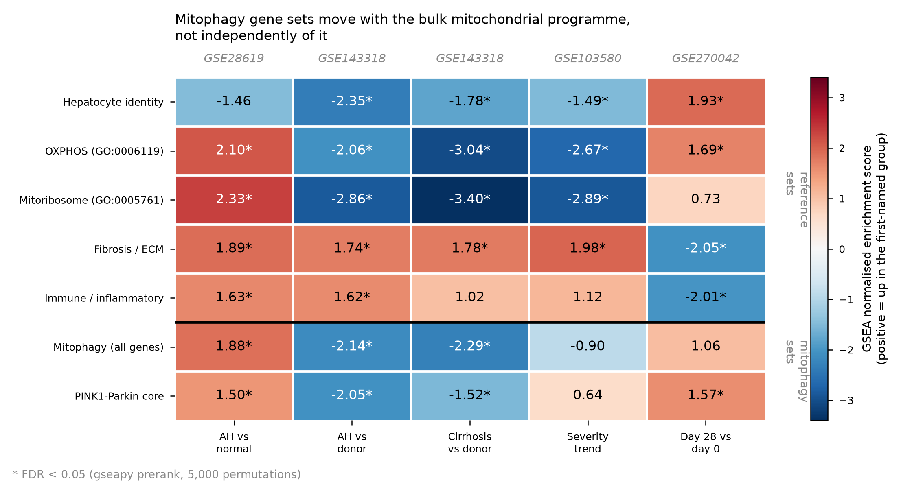
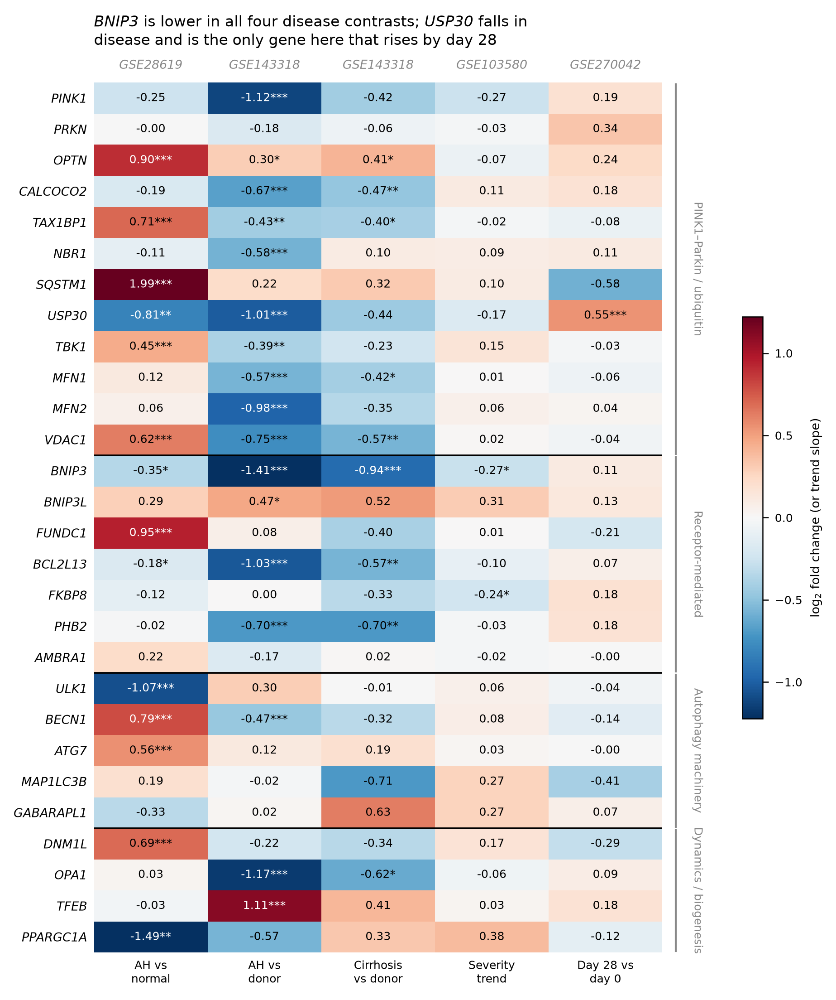
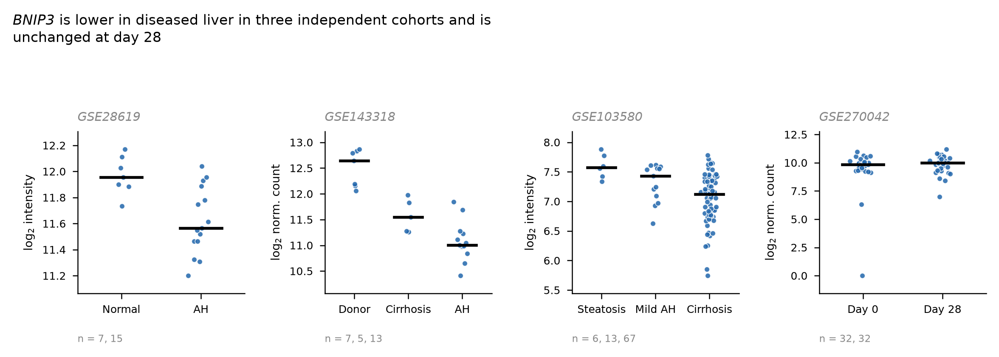
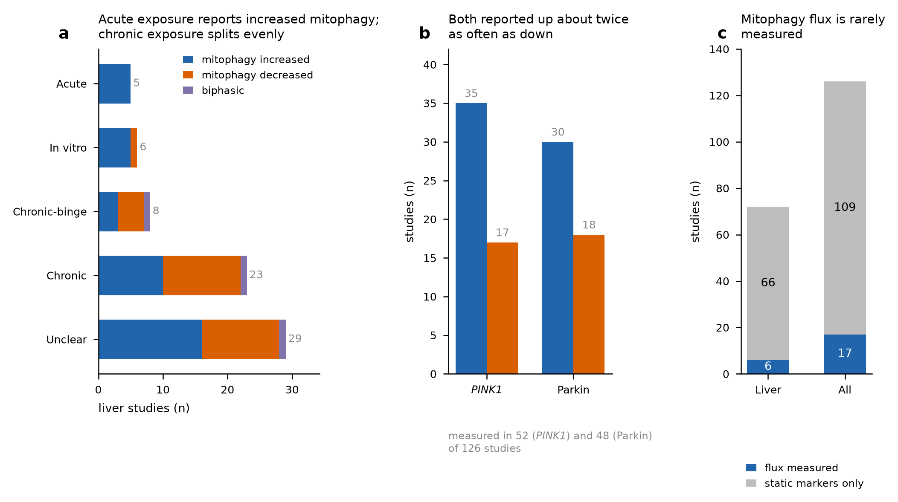

# Mitophagy in alcohol-related liver disease: public transcriptome mining and a literature synthesis

> **Revision 2 — corrected.** This version supersedes revision 1. Three substantive changes
> follow a harmonisation and independent-verification pass (full detail in
> `VERIFICATION.md`):
>
> 1. **A claim is withdrawn.** Revision 1 stated that the PINK1–Parkin core is "the one
>    module that rises during recovery" in the paired contrast. It does not survive removal
>    of seven low-depth libraries and is withdrawn (§1.4).
> 2. **The specificity claim is restated.** The competitive test now uses curated GO
>    reference sets rather than regular-expression ones. The conclusion holds in all four
>    disease contrasts but is statistically significant in three, not four (§1.4).
> 3. **A quality problem is disclosed.** Seven of the 64 paired GSE270042 libraries carry
>    fewer than 10 million reads and were not flagged in revision 1 (§1.1, §1.6).
>
> The gene-level findings, including the central *BNIP3* result, are unchanged and have
> been independently re-tested.

**Scope.** Two linked analyses. Part 1 mines four public human liver transcriptome
cohorts for mitophagy gene expression. Part 2 synthesises 126 primary studies of
alcohol effects on mitophagy retrieved from PubMed. Both were run end to end from
public sources; no unpublished or user-supplied data was used.

---

## Part 1 — Public transcriptome mining

### 1.1 Cohorts

| Dataset | Platform | Contrast tested | n |
|---|---|---|---|
| GSE28619 | Affymetrix HG-U133 Plus 2.0 (GPL570) | Alcoholic hepatitis vs normal liver | 15 vs 7 |
| GSE143318 | RNA-seq (Illumina NextSeq 500) | AH explant vs donor liver; alcoholic cirrhosis vs donor | 13 / 5 / 7 |
| GSE103580 | Affymetrix HG-U219 (GPL13667) | ALD severity trend: steatosis → mild AH → cirrhosis | 6 / 13 / 67 |
| GSE270042 | RNA-seq (NextSeq 2000), ISAIAH trial NCT03775109 | Paired day 28 vs day 0 within AH patients | 32 patients, 64 samples |

The four cohorts answer different questions: two give case–control comparisons on
independent platforms, one gives a within-ALD severity gradient, and one gives a
paired within-patient recovery contrast.

Sample classifications were verified against the raw GEO series matrices (exact agreement
for GSE28619, GSE103580 and GSE270042) and independently against marker-panel biology
(hepatocyte identity highest in controls, fibrosis and inflammation highest in disease,
monotonic across the GSE103580 gradient, reversing on recovery in GSE270042).

Two data-quality facts belong with the cohort table. **GSE143318 has no machine-readable
sample linkage** — the counts file uses `N1`/`AC1`/`AH1` column names while the series
matrix carries GSM accessions, with no supplementary filenames connecting them, so group
assignment is inferred from column prefixes; group sizes and marker biology both agree, but
individual samples cannot be traced. **GSE270042 contains seven low-depth libraries** of
the 64 in the paired set, between 2.15 and 9.65 million reads, one with a median-of-ratios
size factor of 0.010. They are split 4 day-0 / 3 day-28, so they are not confounded with
the contrast, but they materially affect one result (§1.4) and are flagged in
`harmonised_sample_metadata.csv`.

### 1.2 Gene set

154 genes, assembled from GO mitophagy terms (GO:0000422 and descendants,
GO:1903146) via QuickGO, Reactome mitophagy pathways (R-HSA-5205647, R-HSA-5205685,
R-HSA-8934903), and a manually specified core covering the PINK1–Parkin axis,
mitophagy receptors, autophagy machinery, and mitochondrial dynamics/biogenesis.
Legacy microarray symbols were reconciled against NCBI Gene (for example the arrays
annotate *PRKN* as `PARK2`, *ATG101* as `C12orf44`); without that step *PRKN* and 13
other genes are silently missing from the array results.

### 1.3 Statistics

RNA-seq cohorts were analysed with PyDESeq2 (negative-binomial GLM, Wald test),
using `~patient + day` for the paired GSE270042 contrast. Microarray cohorts were
analysed with ordinary least squares per gene — a two-sample t-test for GSE28619 and
a regression on ordinal severity for GSE103580. Benjamini–Hochberg FDR throughout.
Pathway-level testing used `gseapy.prerank` (10,000 permutations) on the per-contrast
test statistic.

> **Methods caveat.** limma's empirical-Bayes variance moderation, which is the field
> standard for microarray data, could not be used: Bioconductor is not distributed for
> Windows through conda, and this sandbox refuses to load compiled R libraries from a
> writable path. The array results therefore use unmoderated t-statistics, which are
> valid but less powerful at the small n of GSE28619 (15 vs 7). Re-running those two
> contrasts under limma would be the first thing to do on a Linux machine.

### 1.4 The pathway-level result is a confounding artefact

Taken at face value, the two case–control cohorts contradict each other. In GSE28619
the mitophagy gene set is enriched **upward** in alcoholic hepatitis (NES +1.87,
FDR 0.001); in GSE143318 the same gene set is enriched **downward** in AH versus donor
liver (NES −2.14, FDR 0.001).

Adding reference gene sets explains why.

In every contrast the mitophagy set simply follows the bulk mitochondrial programme.
Where OXPHOS and mitoribosomal transcripts fall (GSE143318, GSE103580 — alongside loss
of hepatocyte identity and gain of fibrotic and immune signal), mitophagy genes fall
too. Where they rise (GSE28619), mitophagy genes rise. In diseased liver the
hepatocyte compartment shrinks and immune and fibrotic cells expand, so a bulk-tissue
mitochondrial signal is substantially a cell-composition readout, not a regulatory one.

A direct competitive test confirms this and sharpens it. Mitophagy genes were compared by
Mann–Whitney test against a mitochondrial background defined from curated Gene Ontology
terms — GO:0006119 oxidative phosphorylation and GO:0005761 mitochondrial ribosome,
descendants included, 223 symbols with zero overlap with the mitophagy set. Mitophagy
transcripts shift **in the same direction as the mitochondrial background but less far, in
all four disease contrasts**:

| Contrast | median *t*/Wald, mitophagy | median, mitochondrial background | FDR |
|---|---|---|---|
| GSE103580 severity trend | −0.07 | −1.62 | 1.2 × 10⁻¹⁴ |
| GSE143318 cirrhosis vs donor | −1.44 | −2.66 | 3.2 × 10⁻⁹ |
| GSE143318 AH vs donor | −1.80 | −2.72 | 5.1 × 10⁻³ |
| GSE28619 AH vs normal | +1.69 | +2.55 | 0.095 |

**The effect is significant in three of the four disease contrasts.** GSE28619 is the
exception: it reaches FDR 0.049 against a regular-expression background but 0.095 against
the curated one, so that contrast is directionally consistent but not robust to how the
background is defined. Revision 1 reported it as significant; that was an artefact of
background choice.

**Withdrawn claim.** Revision 1 stated that the PINK1–Parkin core "is the one module that
rises during recovery", citing NES +1.58 (nominal p = 0.022, FDR 0.093) in the paired day 28
vs day 0 contrast. Re-running that contrast with the seven low-depth libraries excluded
(25 patients, 50 samples) collapses it to **NES +0.90, p = 0.61, FDR 1.00**. The claim was
never significant after multiplicity correction and is driven by the poor libraries. It is
withdrawn.

What the recovery contrast does show, and show more strongly in the high-depth subset, is
tissue composition normalising: hepatocyte identity NES **+2.29**, fibrosis/ECM **−2.21**,
immune/inflammatory **−2.21**, all FDR < 0.001. Against that, the mitochondrial background
itself is flat (NES −0.65, FDR 0.93). So recovery restores the hepatocyte compartment
without a detectable module-level change in mitochondrial or mitophagy transcription.

**Interpretation.** Relative to the mitochondrial content of the tissue, mitophagy
machinery is *preserved or over-represented* in diseased liver — it is not lost. Any
report of "mitophagy up" or "mitophagy down" in bulk ALD liver that does not control
for mitochondrial and hepatocyte content is reporting tissue composition.

### 1.5 Gene-level results survive the confounding

Nine genes are significant (FDR < 0.05) in at least three of the four disease contrasts
with a consistent direction. The directionally consistent down set is *BNIP3*, *ATG9A*,
*BCL2L13*, *FZD5*, *PPTC7* and *UBB*; the up set is *OPTN*, *CTSK* and *SRC*.

*BNIP3* is the only gene significant in **all four** disease contrasts, always
downward, on both platforms (log₂FC −0.35 to −1.41).

Two further observations worth carrying forward:

1. *USP30*, which encodes the deubiquitinase that opposes Parkin-dependent
   mitophagy, is down in alcoholic hepatitis in both case–control cohorts
   (−0.81 and −1.01) and is the only gene in the panel that rises significantly
   during recovery (+0.55, FDR 2.5 × 10⁻⁵). This survives the low-depth exclusion that
   removed the module-level claim in §1.4: in the 25 high-depth patients it is +0.52,
   FDR 3.1 × 10⁻⁵. Suppression of a mitophagy brake that lifts as disease resolves is a
   coherent, testable story — and it is a gene-level result, not a pathway-level one.
2. *PRKN* mRNA sits at array background in liver (mean log₂ intensity 2.3 in
   GSE28619 and 3.5 in GSE103580, against 8.2 and 6.0 for *PINK1* and 15.4 and 13.1
   for *ALB*) and does not change in any contrast. Hepatic Parkin biology, if real,
   is unlikely to be transcriptionally regulated — consistent with it being
   controlled by recruitment and ubiquitin-ligase activity rather than abundance.

### 1.6 Verification and sensitivity

Every contrast was re-tested with a method making different distributional assumptions:
Wilcoxon rank-sum for the two-group comparisons, Spearman correlation with severity for the
gradient, and Wilcoxon signed-rank on log-CPM for the paired contrast.

| Contrast | sig. original | sig. alternative | overlap | direction agreement |
|---|---|---|---|---|
| GSE28619 AH vs normal | 6,164 | 6,006 | 5,500 | 1.000 |
| GSE103580 severity trend | 980 | 1,671 | 910 | 1.000 |
| GSE143318 AH vs donor | 11,060 | 11,045 | 7,449 | 0.968 |
| GSE143318 cirrhosis vs donor | 6,591 | 5,957 | 3,668 | 1.000 |
| GSE270042 day 28 vs day 0 | 1,069 | 187 | 143 | 1.000 |

**No gene reverses direction in any contrast.** The low overlap in the paired contrast is a
power difference — a signed-rank test over 32 pairs is far weaker than a negative-binomial
GLM — not a disagreement.

*BNIP3* specifically remains significant and downward in all four disease contrasts under
the alternative test (FDR 0.037, 0.013, 0.003, 0.047) and null at day 28 under both. The
central gene-level finding of this study does not depend on the choice of test.

Two format issues in the RNA-seq cohorts were checked and resolved. Rounding the
non-integer GSE270042 estimates is immaterial (maximum change 0.500, no cell altered by
more than 0.5). GSE143318's counts were depth-normalised before deposit, but their
median-of-ratios size factors still span 2.27-fold, so DESeq2's normalisation is doing
necessary work on that dataset — an earlier note in `README_matrices.md` claiming the
size factors would be near 1 was wrong and has been corrected.

---

## Part 2 — Literature synthesis

### 2.1 Method

Three PubMed queries covering alcohol/ethanol crossed with mitophagy, PINK1/Parkin,
and mitochondrial quality control returned 272 unique PMIDs, of which 266 had
abstracts. Each abstract was screened for eligibility (original experimental data,
alcohol as an applied variable, at least one mitophagy readout) and the 126 eligible
records were then extracted into structured fields: species, organ, exposure model and
duration, direction of effect for PINK1, Parkin and mitophagy overall, and whether
mitophagy **flux** was measured rather than inferred from static marker levels.
Screening and extraction were LLM-assisted with a fixed schema; the full table, one row
per study with PMID, is in `literature_evidence_table.csv` and every call is traceable
to its PMID.

### 2.2 Findings

**The field does not agree on direction.** Across 72 liver studies, 39 report increased
mitophagy and 29 decreased (binomial p = 0.28) — indistinguishable from a coin flip.
Restricting to chronic exposure does not help (13 of 29, p = 0.71).

**Exposure duration explains part of the disagreement.** Acute and in-vitro exposures
report increased mitophagy almost uniformly (10 of 11 liver studies), whereas chronic
and chronic-binge models split evenly (Fisher's exact OR 9.7, p = 0.018). This fits a
model in which alcohol acutely triggers mitophagy and chronic exposure exhausts or
blocks it — the same biphasic reading that six studies in the corpus state explicitly.

**PINK1 and Parkin are reported up roughly twice as often as down** — PINK1 increased
in 35 and decreased in 17 of the 52 studies that measured it; Parkin increased in 30
and decreased in 18 of 48. Note that both are measured in fewer than half the studies
in a corpus retrieved partly *by* searching for them.

**Most of the field does not measure flux.** Only 17 of 126 studies (13.5%), and 6 of
72 liver studies (8.3%), used lysosomal inhibitors, mt-Keima/mito-QC reporters, or
another explicit flux measurement. The remainder infer mitophagy from static levels of
PINK1, Parkin, LC3-II or p62 — readouts that cannot distinguish increased initiation
from blocked degradation. That methodological gap is the most plausible single
explanation for the directional disagreement above, and it is directly relevant to the
HepG2 ethanol model: a rise in LC3-II with ethanol is equally consistent with induced
mitophagy and with impaired lysosomal clearance.

### 2.3 Limitations of Part 2

Extraction was from abstracts only, not full texts, so effects reported only in
figures are missed and the directional calls carry the confidence grading in the
evidence table (14 high, 76 medium, 36 low). No study in the corpus was recorded as
reporting "no change", which is implausible as a true description of the literature and
most likely reflects publication bias against null results, possibly compounded by
abstracts not stating nulls. The vote-counting used here is a synthesis of direction,
not a formal effect-size meta-analysis — the primary studies do not report a common
effect measure that would support one.

---

## What these two parts say together

The transcriptome mining and the literature synthesis converge on the same
methodological point from opposite directions. Bulk-tissue transcript levels of
mitophagy genes in human ALD liver are dominated by how much hepatocyte and
mitochondrial content the biopsy contains, and static mitophagy markers in animal and
cell models cannot separate initiation from blockade. Neither measures mitophagy. The
claims that survive both filters are narrow and specific: *BNIP3* is consistently
lower in diseased liver across platforms, *USP30* is suppressed in alcoholic hepatitis
and rises again during resolution, and *PRKN* is not transcriptionally regulated in
liver at all. All three are gene-level results. The pathway-level claims in this study
are negative ones — about what bulk tissue cannot tell you — and the one positive
pathway-level claim revision 1 made did not survive scrutiny.

## Suggested next steps

1. Re-run the two microarray contrasts under limma on a Linux machine and confirm the
   *BNIP3* and *OPTN* results hold with moderated statistics. This matters most for
   GSE28619, the contrast whose specificity result is already borderline.
2. Deconvolve the bulk cohorts (CIBERSORTx or MuSiC against a liver single-cell
   reference) and re-test the mitophagy set with hepatocyte fraction as a covariate.
   This converts the confounding described in §1.4 from a caveat into an adjustment.
3. Re-analyse GSE270042 with the seven low-depth libraries excluded as the primary
   analysis rather than the sensitivity check, and report the full-cohort result as the
   sensitivity version.
4. In the HepG2 ethanol model, measure flux rather than markers — mt-Keima or
   mito-QC, or LC3-II with and without bafilomycin — and read *BNIP3* and *USP30*
   as the primary transcript endpoints.

## Reproducibility and supporting documents

All inputs are public; no unpublished or user-supplied data was used. Analysis
environment: Python 3.11, PyDESeq2 0.5.4, gseapy 1.3.1, scipy 1.17.1, statsmodels 0.15.0.

| Document | Contents |
|---|---|
| `DECISIONS.md` | Every processing decision with its value and justification, tagged rule / judgement call / platform constraint |
| `VERIFICATION.md` | Harmonisation, label verification, count-format resolution and the independent re-assessment behind revision 2 |
| `README_matrices.md` | Per-cohort provenance and processing state of the expression matrices |
| `harmonised_sample_metadata.csv` | 198 samples on a common schema, with QC flags |
| `harmonised_gene_universe.csv` | Gene presence across the four cohorts |
| `de_analysis.py` | Differential expression and module enrichment |

**Known reproducibility gap.** `de_analysis.py` covers the differential expression and
module enrichment only. Retrieval, gene-set construction, symbol reconciliation, the
reference sets, the competitive test and the figures were run interactively and are
documented in `DECISIONS.md` rather than scripted. Consolidating them into one pipeline is
outstanding.
